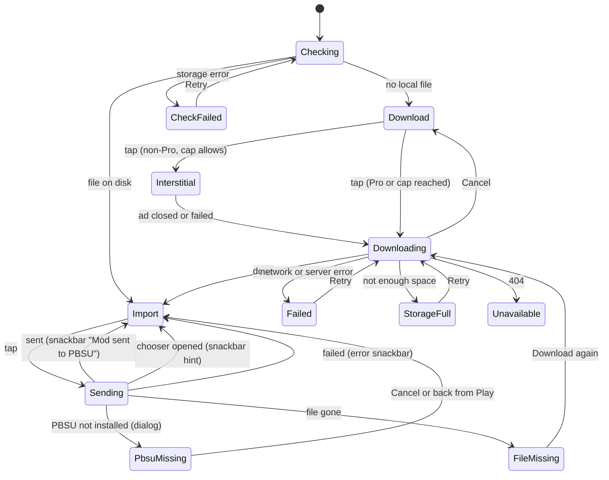

# User flows

Navigation assumed: 4 tabs Home / Search / Library / Settings (recommended). With the 5-tab option, "Library > Downloaded" reads "Downloaded tab" and "Library > Favorites" reads "Favorites tab"; nothing else changes.

## 1. First run
1. Launcher -> Splash (plate wordmark, progress). Splash runs init, cache sync and ad consent.
2. Consent form (UMP, Google's own UI) shows only where required, on top of Splash.
3. Splash -> Home, Bus tab, sort Popular. No onboarding, no paywall.
4. Offline on first run with no cache: Home shows the offline state with Retry; Library is still reachable.

## 2. Browse
1. Home -> swipe or tap a type tab (Bus / Truck / Car / Map). Each tab keeps its own scroll, sort and filters.
2. Tap Popular or Newest. List reloads, scroll goes to top.
3. Scroll: next page loads 3 cards before the end; footer spinner; footer Retry on failure.
4. Pull to refresh at the top.
5. Tap a card -> Detail.

## 3. Filter
1. Home -> "Filters" button -> Filter sheet (body type, manufacturer, country, with counts for this type).
2. Pick options (single choice per section, "All" clears a section). "Show all (88)" expands a section.
3. Apply -> sheet closes, list reloads, active filter chips appear under the sort row, Filters button shows the count ("Filters · 2").
4. Remove one chip -> that filter clears. "Clear filters" in the chips row or "Reset" in the sheet clears all.
5. No results -> "No mods match these filters" + "Clear filters".
6. Dismiss the sheet (swipe down, back, scrim tap) -> nothing changes.

## 4. Search
1. Search tab -> field focused, keyboard up, prompt text and type chips (All types, Bus, Truck, Car, Map).
2. Type: results update 300 ms after the last keystroke (existing `SearchBloc.debounce`). Field clear button appears.
3. Results -> tap -> Detail. Back returns to the same results and scroll.
4. No results -> "No mods found for “query”" + hint; if a type is selected, a "Search all types" button.
5. Network error -> inline error with Retry; offline -> offline state.

## 5. Detail -> download -> import (main loop)

Steps:
1. Detail opens: bar shows Checking (disabled, spinner) for the time it takes to look on disk, usually under 100 ms.
2. Tap **Download · 60 MB**. Non-Pro: interstitial may show first (frequency cap). The download starts when the ad closes or fails.
3. Bar shows progress: bar fill, "Downloading 42%", "25 of 60 MB", Cancel. Leaving the page does not stop the download; coming back shows live progress.
4. Done: bar shows "Downloaded · 60 MB" status and **Import to PBSU**. The record appears in Library > Downloaded.
5. Tap Import: button shows a spinner while the intent is sent (guards double taps). PBSU opens and installs the mod itself.
6. Back in Busmod: snackbar "Mod sent to PBSU". The button stays **Import to PBSU** for re-imports.
7. PBSU not installed: dialog "PBSU is not installed" with **Open Google Play** and Cancel.
8. Chooser fallback: system chooser opens, snackbar "Pick PBSU in the list to import this mod".
9. Failed import: error snackbar "PBSU could not open this mod. Try again."

## 6. Library
1. Library tab -> segment Downloaded (default) or Favorites; the last segment used is remembered for the session.
2. Downloaded: summary "4 mods · 312 MB", rows with thumbnail, title, "ZIP · 60 MB", Import, Delete. Works offline (snapshots).
3. Import from a row: same results as Detail (snackbars, PBSU dialog).
4. Delete: icon button -> confirm dialog "Delete this mod?" with the size freed -> row removed, summary updates, snackbar "Mod deleted".
5. File not found (detected on Import): row shows "File not found" with icon, Import is replaced by **Download again**, which opens Detail where the bar shows Download again.
6. Tap a row (outside buttons) -> Detail (needs network; offline -> Detail offline state, the Library row is still usable).

## 7. Favorites
1. Detail -> heart in the app bar toggles; TalkBack says "Added to favorites" / "Removed from favorites".
2. Library > Favorites: cards (same as Home) with a filled heart; tap heart removes with an Undo snackbar ("Removed from favorites", Undo).
3. Empty -> "No favorites yet" + "Browse mods" (goes to Home).

## 8. Settings
1. Settings tab: Pro card (or "You're Pro" card), Appearance (System / Light / Dark), Language (English / Tiếng Việt), Purchases (Restore), About (Privacy policy, Terms of use, Privacy choices when consent applies (feature `fe-consent-privacy`), Version).
2. Theme and language apply immediately, no restart.
3. Restore: row shows a spinner, then a snackbar (restored / nothing to restore / failed).

## 9. Pro purchase
1. Entry: Settings Pro card, or "Remove ads" on an in-list ad.
2. Paywall: headline, what Pro does (removes all ads), what it does not change (mods stay free), price per month, Subscribe, Restore, renewal note.
3. Subscribe -> Google Play sheet -> success: snackbar "You're Pro. Ads are gone.", paywall closes, ads disappear without restart.
4. Pending payment: snackbar "Payment pending…", paywall stays.
5. Failure or cancel by user: failure shows the error snackbar; a user cancel shows nothing.
6. Store unavailable: price hidden, message + Retry, Subscribe disabled.

## 10. Error and offline paths (all screens)

| Situation | What the user sees | Way out |
|---|---|---|
| Offline, nothing cached | Offline view (illustration, "You're offline", "Check your connection. Your downloaded mods still work in Library.") | Retry, Open Library |
| Offline, cached list | Cached list stays; a slim banner "Offline. Showing saved results." under the toolbar | Banner disappears when back online |
| Server error | Error view "Something went wrong on our side. Try again in a moment." | Retry |
| Load-more fails | Footer "Couldn't load more" | Retry in footer |
| Detail 404 | "This mod is no longer available" view, no Retry | Back |
| Download network failure | Bar: error icon + "Download stopped. Check your connection." | Retry |
| Storage full | Bar: "Not enough space. Free up 60 MB and try again." | Retry |
| File gone from disk | Bar or row: "File not found on this device" | Download again |
